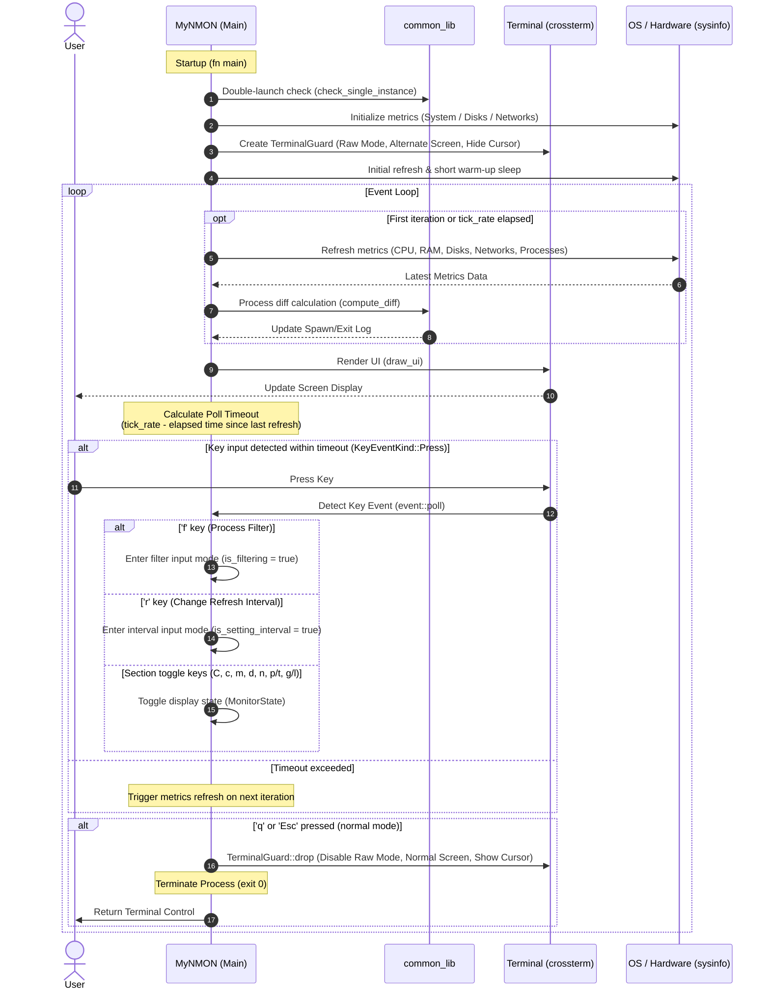
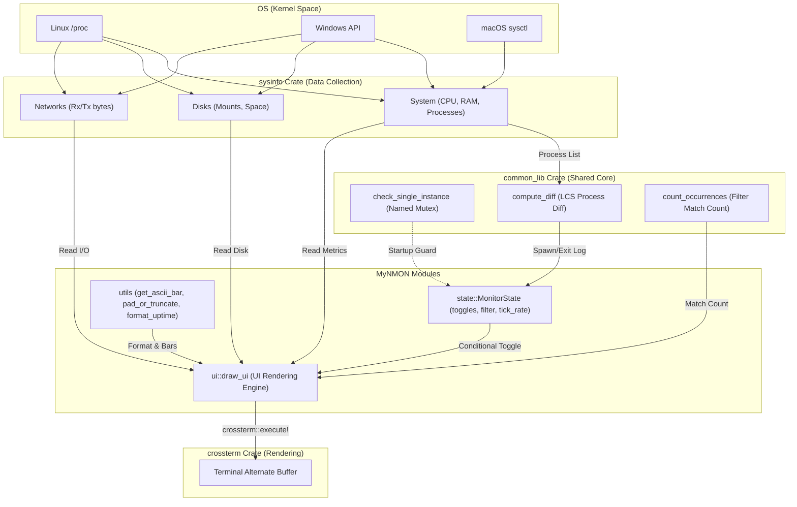

# System Architecture Diagram (DIAGRAM.md)

**English** | [日本語版](../ja/DIAGRAM.md)

This document provides diagrams illustrating the threads, lifecycle, data collection pathways, and event control flow of `MyNMON`.

---

## 1. Application Lifecycle and Event Loop

`MyNMON` achieves low-latency key responsiveness and accurate periodic metric collection within a single thread by combining Crossterm event polling with elapsed-time tracking.

---

## 2. Data Flow and Rendering Path

The following diagram illustrates how metrics collected from the OS via `sysinfo` and analysis results from `common_lib` are processed and rendered to the terminal buffer:

