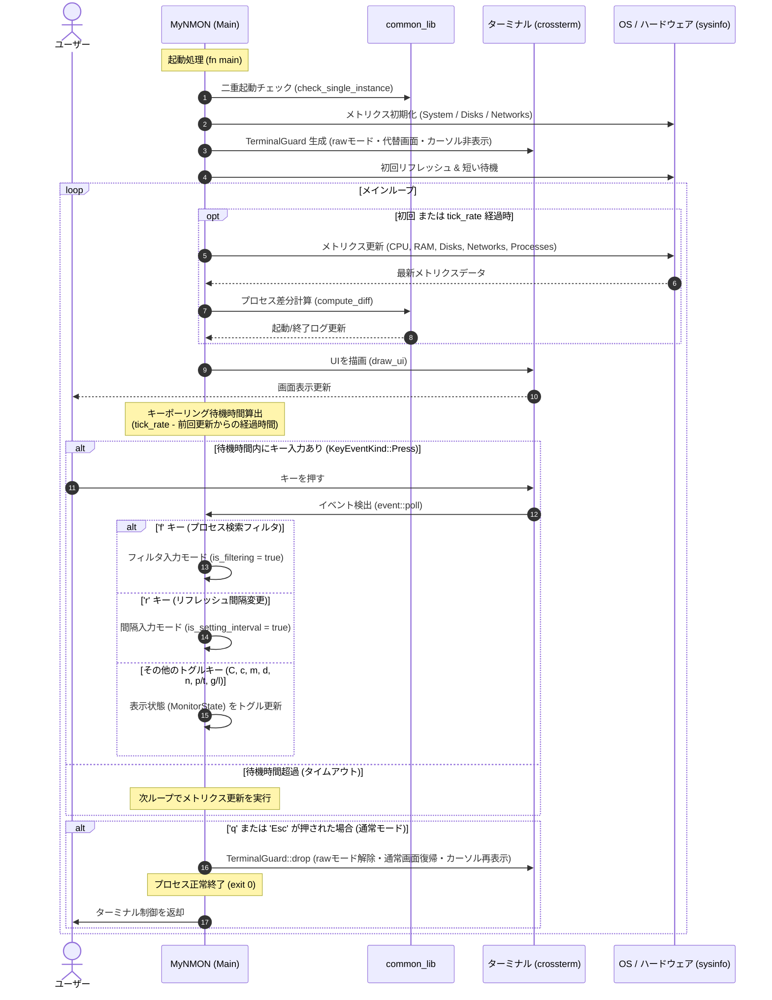
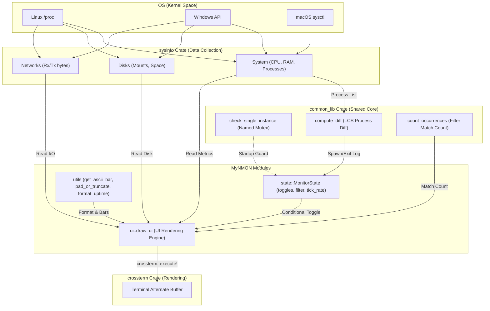

# システム構成図 (DIAGRAM.md)

[English](../en/DIAGRAM.md) | **日本語版**

本ドキュメントは、`MyNMON` のスレッド、ライフサイクル、データ取得経路、およびイベント制御フローをダイアグラムで示したものです。

---

## 1. アプリケーションのライフサイクルとイベントループ

`MyNMON` は、crossterm のイベントポーリングと経過時間算出を組み合わせることで、低レイテンシーなキー応答と正確な定期メトリクス更新を単一スレッドで両立しています。

---

## 2. データの取得と描画フロー

`sysinfo` を介して OS から収集したシステムデータおよび `common_lib` の解析結果が、どのように処理されてターミナルに描画されるかのデータ経路です。

